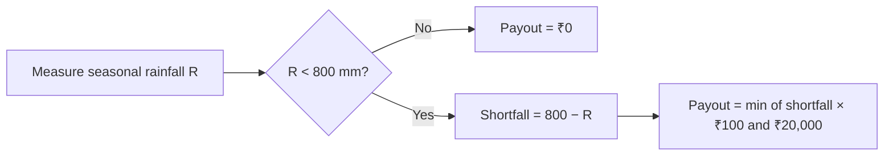
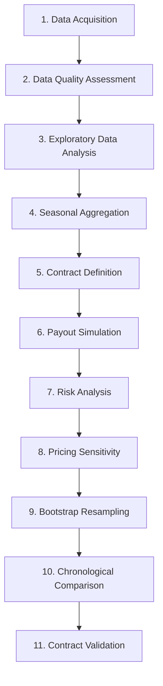

<div align="center">
# 🌧️ PluviaRisk
 
### Parametric Rainfall Insurance Risk Modelling
 
*Quantifying rainfall risk through data-driven insurance modelling*
 


 
**Historical monsoon rainfall → simulated payouts → expected claims → pricing sensitivity**
 
[Overview](#-overview) •
[Contract](#-insurance-contract-design) •
[Results](#-key-results-at-a-glance) •
[Setup](#-installation-and-setup) •
[Limitations](#-assumptions-and-limitations)
 
</div>
---
 
## 📑 Table of Contents
 
1. [Overview](#-overview)
2. [Problem Statement](#-problem-statement)
3. [Project Objectives](#-project-objectives)
4. [How Parametric Insurance Works](#-how-parametric-insurance-works)
5. [Dataset](#-dataset)
6. [Technology Stack](#-technology-stack)
7. [Project Structure](#-project-structure)
8. [Methodology](#-methodology)
9. [Insurance Contract Design](#-insurance-contract-design)
10. [Exploratory Data Analysis](#-exploratory-data-analysis)
11. [Payout Modelling](#-payout-modelling)
12. [Risk and Pricing Analysis](#-risk-and-pricing-analysis)
13. [Trigger Sensitivity Analysis](#-trigger-sensitivity-analysis)
14. [Statistical Analysis](#-statistical-analysis)
15. [Model Validation](#-model-validation)
16. [Chronological Calibration and Test Comparison](#-chronological-calibration-and-test-comparison)
17. [Key Results at a Glance](#-key-results-at-a-glance)
18. [Installation and Setup](#-installation-and-setup)
19. [How to Run](#-how-to-run)
20. [Assumptions and Limitations](#-assumptions-and-limitations)
21. [Future Improvements](#-future-improvements)
22. [Disclaimer](#-disclaimer)
23. [Author](#-author)
---
 
## 🔭 Overview
 
**PluviaRisk** explores how historical rainfall data can be used to design and evaluate a simple **parametric rainfall insurance contract**.
 
The project uses daily precipitation observations for **Ahmedabad, Gujarat, India (2015–2024)**. Daily observations are aggregated into **June–September monsoon seasons** and used to simulate insurance payouts under a predefined rainfall trigger.
 
The analysis combines data processing, exploratory data analysis, quantitative risk metrics, payout simulation, premium sensitivity analysis, bootstrap resampling, and chronological evaluation. The goal is to demonstrate the quantitative workflow behind a simplified rainfall-linked insurance product.
 
### ✨ Key Features
 
| | Feature |
|:-:|---|
| 🌐 | Historical rainfall acquisition via a weather API |
| 🧹 | Data cleaning and quality checks |
| 📊 | Daily and seasonal rainfall analysis |
| 🌦️ | Monsoon rainfall aggregation |
| 💸 | Parametric insurance payout simulation |
| 📈 | Claim frequency and severity analysis |
| 🎯 | Expected annual payout estimation |
| 🏷️ | Indicative premium calculation |
| 🎚️ | Trigger sensitivity analysis |
| 🔁 | Bootstrap resampling for uncertainty exploration |
| ⏳ | Chronological calibration and test-period comparison |
| ✅ | Automated validation of insurance contract rules |
 
---
 
## 🧩 Problem Statement
 
Agriculture and other weather-sensitive economic activities are exposed to rainfall variability, drought conditions, and extreme precipitation events.
 
Traditional insurance may require individual loss assessments, which can involve additional time and administrative effort. **Parametric insurance** offers an alternative: payouts depend on predefined, measurable environmental conditions rather than solely on the assessment of actual individual losses.
 
Designing a useful parametric product requires careful consideration of:
 
- Historical weather patterns
- Trigger thresholds
- Payout structures
- Expected claims
- Pricing assumptions
- Uncertainty in historical estimates
- The relationship between the selected trigger and actual economic losses
PluviaRisk implements a simplified analytical framework to investigate these factors using historical monsoon rainfall.
 
---
 
## 🎯 Project Objectives
 
1. Collect and analyse historical rainfall observations.
2. Understand rainfall distribution and seasonal variability.
3. Calculate annual and monsoon-season rainfall metrics.
4. Define a hypothetical parametric rainfall insurance contract.
5. Simulate payouts using a predefined trigger and payout schedule.
6. Estimate historical claim frequency and average payout.
7. Explore indicative premiums under different loading assumptions.
8. Evaluate the sensitivity of expected payouts to trigger selection.
9. Use bootstrap resampling to investigate uncertainty in historical payout estimates.
10. Compare payout behaviour across chronological calibration and test periods.
11. Identify limitations that must be addressed before real-world insurance pricing.
---
 
## ☔ How Parametric Insurance Works
 
Parametric insurance uses a **predefined measurable variable** (rainfall, temperature, wind speed, etc.) to determine whether a payout is triggered. In a rainfall-linked product, the contract may specify a minimum seasonal rainfall threshold.
 
**Example contract**
 
| Term | Value |
|---|---|
| Seasonal rainfall trigger | 800 mm |
| Payout rate | ₹100 per mm below the trigger |
| Maximum payout | ₹20,000 |
 

 
- If rainfall is **750 mm**, the shortfall is 50 mm → payout **₹5,000**.
- If rainfall is **1,000 mm**, the trigger is not breached → payout **₹0**.
> [!NOTE]
> The contract is evaluated using the agreed rainfall measurement and the exact policy terms.
 
---
 
## 🗂️ Dataset
 
### Data Source
 
Historical daily precipitation was retrieved from the **Open-Meteo Historical Weather API**:
 
```text
https://archive-api.open-meteo.com/v1/archive
```
 
### Geographic and Temporal Scope
 
| Parameter | Value |
|---|---|
| Location | Ahmedabad, Gujarat, India |
| Latitude | 23.0225 |
| Longitude | 72.5714 |
| Start date | 2015-01-01 |
| End date | 2024-12-31 |
| Original observations | 3,653 daily records |
| Primary variable | Daily precipitation |
| Unit | Millimetres |
| Time zone | Asia/Kolkata |
 
### Dataset Fields
 
| Column | Description |
|---|---|
| `date` | Date of the rainfall observation |
| `rainfall_mm` | Daily precipitation in millimetres |
| `year` | Calendar year derived from the observation date |
 
The monsoon analysis uses observations from **June through September**, giving **ten annual monsoon observations** (2015–2024).
 
### Data Quality Checks
 
- Missing dates and missing rainfall values
- Number of observations
- Zero-rainfall days
- Rainfall distribution
- Extreme daily rainfall observations
- Annual and seasonal aggregation consistency
The retrieved dataset contained **3,653 records** with **no missing values** in the date or rainfall columns.
 
> [!IMPORTANT]
> **Reproducibility note:** Historical API responses can change as weather datasets are revised, so re-running the request may produce slightly different values. Preserve the downloaded dataset alongside the notebook.
 
---
 
## 🛠️ Technology Stack
 
| Technology | Purpose |
|---|---|
| **Python** | Main programming language |
| **Pandas** | Data manipulation and aggregation |
| **NumPy** | Numerical calculations and bootstrap resampling |
| **Matplotlib** | Statistical visualisation |
| **Requests** | API communication |
| **Kaggle Notebooks** | Development and execution environment |
| **Git and GitHub** | Version control and project hosting |
 
---
 
## 📁 Project Structure
 
```text
PluviaRisk/
│
├── README.md
├── PluviaRisk.ipynb
├── requirements.txt
├── .gitignore
│
├── data/
│   └── monsoon_rainfall_payouts.csv
│
└── outputs/
    ├── trigger_sensitivity.csv
    └── calibration_test_comparison.csv
```
 
| File | Description |
|---|---|
| `README.md` | Project documentation, methodology, results, and limitations |
| `PluviaRisk.ipynb` | Data retrieval, analysis, payout simulation, statistics, and visualisations |
| `requirements.txt` | Python dependencies |
| `data/monsoon_rainfall_payouts.csv` | Seasonal rainfall and simulated payout results |
| `outputs/trigger_sensitivity.csv` | Historical payout estimates under different rainfall triggers |
| `outputs/calibration_test_comparison.csv` | Summary of calibration and test-period results |
| `.gitignore` | Excludes temporary files and unnecessary local artifacts |
 
> [!TIP]
> The structure above is the intended repository layout. Create the `data/` and `outputs/` directories when organising the downloaded files.
 
---
 
## 🔬 Methodology
 
The project follows a sequential quantitative workflow.
 

 
| Step | Stage | What happens |
|:-:|---|---|
| 1 | **Data Acquisition** | Daily precipitation downloaded via the Open-Meteo API and converted to a Pandas DataFrame |
| 2 | **Data Quality Assessment** | Inspected for missing values and basic consistency (3,653 observations, none missing) |
| 3 | **Exploratory Data Analysis** | Mean, median, standard deviation, min/max, dry-day frequency, distribution, annual totals |
| 4 | **Seasonal Aggregation** | Filtered to June–September; daily values summed per year |
| 5 | **Contract Definition** | Hypothetical contract with a seasonal trigger, payout rate, and maximum payout |
| 6 | **Payout Simulation** | Each monsoon season evaluated against the trigger |
| 7 | **Risk Analysis** | Payout frequency, average annual payout, total payouts, average payout given a claim |
| 8 | **Pricing Sensitivity** | Premium loading assumptions and alternative triggers tested |
| 9 | **Bootstrap Resampling** | Annual payouts resampled with replacement to explore uncertainty |
| 10 | **Chronological Comparison** | Split into calibration and later test periods |
| 11 | **Contract Validation** | Assertions confirm payouts are non-negative, capped, and match the formula |
 
---
 
## 📜 Insurance Contract Design
 
The project uses the following **illustrative** contract parameters.
 
| Parameter | Value |
|---|---:|
| Reference location | Ahmedabad |
| Covered season | June–September |
| Rainfall trigger | 800 mm |
| Payout rate | ₹100 per mm below trigger |
| Maximum payout | ₹20,000 per season |
| Premium loading assumption | 25% (initial example) |
 
### Payout Formula
 
Let:
 
- $R$ = observed seasonal rainfall (mm)
- $T$ = rainfall trigger
- $k$ = payout per millimetre of shortfall
- $M$ = maximum payout
$$
P(R) = \min\Big(\max(T - R,\ 0) \times k,\ M\Big)
$$
 
For the initial contract: $T = 800$, $k = 100$, $M = 20{,}000$.
 
### Example Calculations
 
| Seasonal rainfall | Shortfall | Payout |
|---:|---:|---:|
| 500 mm | 300 mm | ₹20,000 *(capped)* |
| 600 mm | 200 mm | ₹20,000 |
| 750 mm | 50 mm | ₹5,000 |
| 800 mm | 0 mm | ₹0 |
| 1,000 mm | 0 mm | ₹0 |
 
> [!NOTE]
> These examples illustrate the contractual payout mechanism, not an empirically validated insurance product.
 
---
 
## 📊 Exploratory Data Analysis
 
### Daily Rainfall
 
| Metric | Observed value |
|---|---:|
| Daily observations | 3,653 |
| Mean daily rainfall | 2.83 mm |
| Median daily rainfall | 0 mm |
| Standard deviation | 12.42 mm |
| Minimum daily rainfall | 0 mm |
| Maximum daily rainfall | 339.9 mm |
| Dry days | 2,530 |
| Rainy days | 1,123 |
| Percentage of dry days | 69.26% |
 
The distribution has a large concentration of zero-rainfall observations and a long right tail. Daily rainfall is therefore strongly non-normal, and extreme observations can substantially influence summary statistics.
 
### Monsoon (June–September) Rainfall
 
| Metric | Observed value |
|---|---:|
| Number of monsoon seasons | 10 |
| Average seasonal rainfall | 971.34 mm |
| Standard deviation | 304.43 mm |
| Minimum seasonal rainfall | 564.9 mm |
| Maximum seasonal rainfall | 1,561.5 mm |
 
Seasonal rainfall varies substantially between years. These observations are a starting point for trigger analysis, but **ten seasons are insufficient to establish a robust long-term climate-risk distribution**.
 
---
 
## 💸 Payout Modelling
 
The initial contract was applied to all ten monsoon seasons.
 
| Year | Monsoon rainfall (mm) | Simulated payout |
|:-:|---:|---:|
| 2015 | 564.9 | ₹20,000 |
| 2016 | 594.0 | ₹20,000 |
| 2017 | 1,561.5 | ₹0 |
| 2018 | 750.0 | ₹5,000 |
| 2019 | 1,177.4 | ₹0 |
| 2020 | 984.8 | ₹0 |
| 2021 | 935.5 | ₹0 |
| 2022 | 949.5 | ₹0 |
| 2023 | 935.4 | ₹0 |
| 2024 | 1,260.4 | ₹0 |
 
### Worked Examples
 
**2018** — shortfall of 50 mm:
 
$$
P = \min\big((800 - 750) \times 100,\ 20{,}000\big) = ₹5{,}000
$$
 
**2015** — shortfall of 235.1 mm:
 
$$
P = \min\big((800 - 564.9) \times 100,\ 20{,}000\big) = \min(23{,}510,\ 20{,}000) = ₹20{,}000
$$
 
The uncapped payout exceeds the maximum, so the contract pays ₹20,000.
 
### Historical Payout Summary
 
| Metric | Result |
|---|---:|
| Total seasons | 10 |
| Seasons with payouts | 3 |
| Historical payout frequency | 30% |
| Total payouts | ₹45,000 |
| Average annual payout | ₹4,500 |
| Average payout conditional on a claim | ₹15,000 |
| Maximum annual payout | ₹20,000 |
 
> [!NOTE]
> The **average annual payout** includes all ten seasons (including zero-payout years). The **conditional average** includes only the three seasons with positive payouts.
 
---
 
## 💰 Risk and Pricing Analysis
 
### 1. Expected Annual Payout
 
The historical expected payout is the average payout across all 10 observed monsoon seasons.
 
$$
\text{Average Annual Payout} = \frac{\text{Total Historical Payouts}}{\text{Number of Seasons}} = \frac{₹45{,}000}{10} = ₹4{,}500
$$
 
This is the historical average payout under the selected contract. It is **not** automatically the premium required for a sustainable insurance product.
 
### 2. Indicative Premium
 
A simplified premium estimate applies a loading rate to the historical average payout.
 
$$
\text{Indicative Premium} = \text{Average Annual Payout} \times (1 + \text{Loading Rate})
$$
 
$$
₹4{,}500 \times (1 + 0.25) = ₹5{,}625
$$
 
The resulting illustrative annual premium is **₹5,625 per policy**.
 
> [!WARNING]
> The 25% loading is hypothetical. It has not been calibrated using actual expenses, capital requirements, reinsurance costs, or actuarial risk margins.
 
### 3. Premium Sensitivity
 
| Assumed loading | Indicative annual premium |
|---:|---:|
| 10% | ₹4,950 |
| 25% | ₹5,625 |
| 40% | ₹6,300 |
| 50% | ₹6,750 |
 
This shows how premium estimates change with the loading assumption. It does not establish which loading is appropriate for a commercial product.
 
---
 
## 🎚️ Trigger Sensitivity Analysis
 
The payout model was evaluated under alternative triggers, keeping the payout rate at ₹100 per mm and the maximum payout at ₹20,000.
 
| Rainfall trigger | Payout frequency | Average annual payout |
|---:|---:|---:|
| 700 mm | 20% | ₹2,411 |
| 800 mm | 30% | ₹4,500 |
| 900 mm | 30% | ₹5,500 |
| 1,000 mm | 70% | ₹7,948 |
 
A higher rainfall trigger generally increases payout exposure under this contract. Payout frequency and average payout do not necessarily rise at the same rate, because the amount paid in each triggered season also matters (compare the 800 mm and 900 mm rows: same frequency, higher average payout).
 
Trigger selection should ultimately reflect the intended coverage, agricultural requirements, available loss data, and the financial characteristics of the product.
 
---
 
## 📉 Statistical Analysis
 
### 1. Bootstrap Resampling
 
Bootstrap resampling investigates how the estimated average annual payout varies when the ten historical annual payouts are resampled with replacement.
 
| Setting | Value |
|---|---|
| Bootstrap samples | 10,000 |
| Observations per sample | 10 |
| Statistic per sample | Average annual payout |
| Interval method | 2.5th and 97.5th percentiles |
| Approximate 95% interval (initial run) | **₹0 – ₹10,000** |
 
> [!CAUTION]
> The interval is sensitive to the small sample and to the presence of both zero-payout years and maximum-payout years. It is not a guarantee of future payouts or a complete actuarial uncertainty estimate.
 
### 2. Annual Payout Variability
 
| Metric | Result |
|---|---:|
| Mean annual payout | ₹4,500 |
| Standard deviation of annual payouts (sample, n − 1) | ₹8,316.65 |
| Years with zero payout | 7 |
| Years with maximum payout | 2 |
 
The large standard deviation relative to the mean indicates substantial variability in annual payouts, reinforcing the need for a longer historical record and more comprehensive risk modelling before any pricing decision.
 
---
 
## ✅ Model Validation
 
Payout calculations were validated with automated assertions that verify:
 
1. Every payout is **non-negative**.
2. No payout **exceeds the maximum** contractual payout.
3. The simulated payout **matches the specified formula** for the trigger and payout rate.
**All validation checks passed.**
 
> [!NOTE]
> These checks show that the calculation follows the implemented contract rules. They do not show that the contract is economically optimal or that the model predicts future rainfall.
 
---
 
## ⏳ Chronological Calibration and Test Comparison
 
Observations were split chronologically:
 
- **Calibration period:** 2015–2021
- **Test period:** 2022–2024
The same illustrative 800 mm trigger and payout structure were used throughout.
 
| Metric | Calibration | Test |
|---|---:|---:|
| Number of years | 7 | 3 |
| Trigger breaches | 3 | 0 |
| Trigger breach frequency | 42.86% | 0% |
| Total payouts | ₹45,000 | ₹0 |
| Average annual payout | ₹6,428.57 | ₹0 |
 
The test period had no trigger breaches because all three seasonal totals exceeded 800 mm. This illustrates **sensitivity to the observation period**, not a failure of the contract.
 
> [!WARNING]
> The test period contains only three seasons, so the comparison cannot establish reliable long-term payout frequency or premium adequacy. The trigger was also set as a hypothetical parameter rather than selected through a formal training procedure, so this is a chronological *stability check*, not a full predictive validation.
 
---
 
## 🏁 Key Results at a Glance
 
| Metric | Value |
|---|---:|
| Monsoon seasons analysed | 10 (2015–2024) |
| Average monsoon rainfall | 971.34 mm |
| Historical payout frequency (800 mm trigger) | 30% |
| Total historical payouts | ₹45,000 |
| Average annual payout | ₹4,500 |
| Average payout given a claim | ₹15,000 |
| Indicative premium (25% loading) | ₹5,625 |
| Approx. 95% bootstrap interval for mean payout | ₹0 – ₹10,000 |
| Calibration vs test average payout | ₹6,428.57 vs ₹0 |
| Contract validation checks | All passed |
 
---
 
## ⚙️ Installation and Setup
 
### Prerequisites
 
- Python 3.10 or later (recommended)
- Jupyter Notebook or Kaggle Notebooks
- Internet access for the initial API request
### Clone the Repository
 
```bash
git clone <YOUR_GITHUB_REPOSITORY_URL>
cd PluviaRisk
```
 
Replace the placeholder with your actual GitHub repository URL.
 
### Install Dependencies
 
```bash
pip install -r requirements.txt
```
 
---
 
## ▶️ How to Run
 
1. Clone or download the repository.
2. Install the dependencies.
3. Open `PluviaRisk.ipynb` in Jupyter Notebook, or upload it to Kaggle.
4. Execute the notebook cells in order.
5. Retrieve the historical rainfall data if required.
6. Review the descriptive statistics and visualisations.
7. Execute the payout simulation.
8. Review the trigger and premium sensitivity analyses.
9. Inspect the bootstrap results and chronological comparison.
10. Review the exported CSV files.
<details>
<summary><b>📦 Expected outputs</b></summary>
<br>
- Daily rainfall statistics
- Annual rainfall summaries
- Monsoon rainfall summaries
- Historical payout calculations
- Payout frequency and severity metrics
- Premium sensitivity results
- Bootstrap distribution and interval
- Trigger sensitivity comparison
- Calibration and test-period comparison
- Contract validation results
- CSV files for further analysis
</details>
---
 
## ⚠️ Assumptions and Limitations
 
This is an **educational quantitative modelling project**. Interpret results within these limitations.
 
| Limitation | Details |
|---|---|
| **Limited historical sample** | Only ten monsoon seasons — small for estimating rare events, long-term variability, and payout distributions. |
| **Single geographic location** | One set of coordinates in Ahmedabad; results do not generalise to other regions or individual farms. |
| **Simplified rainfall trigger** | The 800 mm trigger is illustrative, not calibrated to crop water needs, soil, crop calendars, or historical losses. |
| **Simplified payout structure** | Fixed payout per mm below the trigger, with a cap. Real products may use more complex schedules and conditions. |
| **No actual loss dataset** | No crop-loss or farmer-income data, so basis risk and the rainfall–loss relationship are not quantified. |
| **Simplified premium calculation** | Hypothetical loading over the historical mean; excludes expenses, uncertainty, capital costs, reinsurance, and regulation. |
| **Bootstrap limitations** | Resampling ten seasons cannot capture climate trends, structural changes, or events absent from the sample. |
| **Limited test period** | Three seasons only; the zero-payout result is not a forecast of future claim frequency. |
| **Data source limitations** | Weather data may be revised, and the chosen coordinates may not represent rainfall at every insured farm. |
 
---
 
## 🚀 Future Improvements
 
1. **Longer historical analysis** — extend the observation period where reliable data is available.
2. **Regional risk modelling** — compare multiple locations and spatial rainfall patterns.
3. **Crop-specific triggers** — incorporate crop calendars and agricultural requirements.
4. **Basis risk analysis** — integrate actual crop-loss observations or a defensible loss proxy.
5. **Trigger optimisation** — evaluate triggers against a clearly defined insurance objective.
6. **Advanced statistical modelling** — investigate extreme-value methods and suitable rainfall distributions.
7. **Climate trend analysis** — examine changes in seasonal rainfall and extreme-event frequency.
8. **Actuarial pricing** — incorporate expenses, uncertainty, capital requirements, and justified risk margins.
9. **Out-of-sample evaluation** — use longer chronological holdouts and rolling-origin evaluation.
10. **Interactive dashboard** — explore triggers, payouts, and pricing scenarios.
11. **Automated data pipeline** — separate retrieval, preprocessing, modelling, and reporting into reusable modules.
12. **Reproducibility improvements** — record retrieval dates, preserve source data, and document dependency versions.
---
 
## 📌 Disclaimer
 
PluviaRisk is an educational and analytical project demonstrating quantitative risk modelling concepts using historical rainfall data.
 
The contract parameters and premium loading assumptions are illustrative. Estimated payouts and premiums are **not** validated commercial insurance prices, actuarial advice, or a recommendation to issue an insurance product.
 
Real-world implementation would require appropriate loss data, robust statistical validation, product-specific calibration, and review by qualified insurance and actuarial professionals.
 
---
 
## 👤 Author
 
**Kunal Pramanik**
M.Sc. Data Science — Dhirubhai Ambani University (DA-IICT), Gandhinagar, India
 
[](https://github.com/Kunal-Pramanik)
[](https://linkedin.com/in/kunal-pramanik-5aa131267)
 
---
 
<div align="center">
*PluviaRisk — Quantifying rainfall risk through data-driven insurance modelling.*
 
</div>
